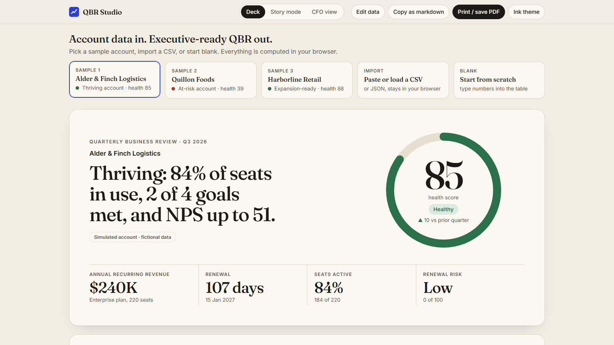
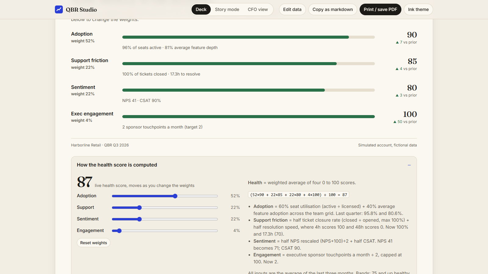

# QBR STUDIO

Paste one account's monthly numbers and get an executive-ready Quarterly Business Review, with a verdict, a health score you can re-weight live, and a 60-second talk track.

**[Live demo](https://tootenramen.github.io/QBR-Studio/)**

## What you can do

- Load a thriving, an at-risk or an expansion-ready sample account in one click, import a CSV or JSON, or start blank and type into an editable table.
- Read a scrollable, print-ready deck: single-line verdict, health score, value realized against the customer's own goals (progress rings), a team-by-feature adoption heatmap, 3 wins, 3 risks with owner and date, a renewal-risk meter with reasons, and an asks slide.
- Drag the four weight sliders (adoption, support, sentiment, engagement) and watch the score, verdict and renewal risk move.
- Flip to **Story mode** for a deterministic 60-second talk track with a rehearsal timer, or **CFO view** for the same data as cost, time saved and ARR exposed.
- **Print / save PDF** (one slide per landscape page) or **Copy as markdown**.

## How it works

Everything is plain HTML, CSS and JavaScript in one file, with charts drawn as inline SVG. All math is explicit: health is a weighted average of four 0-100 scores, renewal risk is a sum of named rules where each reason shows its points, and the talk track is built from templates and rules (no AI service, no network calls, nothing stored). Data you type or import never leaves your browser. All sample accounts are fictional and labelled as simulated.

**Skills this shows:** customer success storytelling, explainable scoring models, data visualisation with SVG, print-first CSS, accessible and responsive front-end work.

Built by Gustavo Freitas - [LinkedIn](https://www.linkedin.com/in/gustavo-freitas-69b93910b/) - [more projects](https://github.com/Tootenramen)
